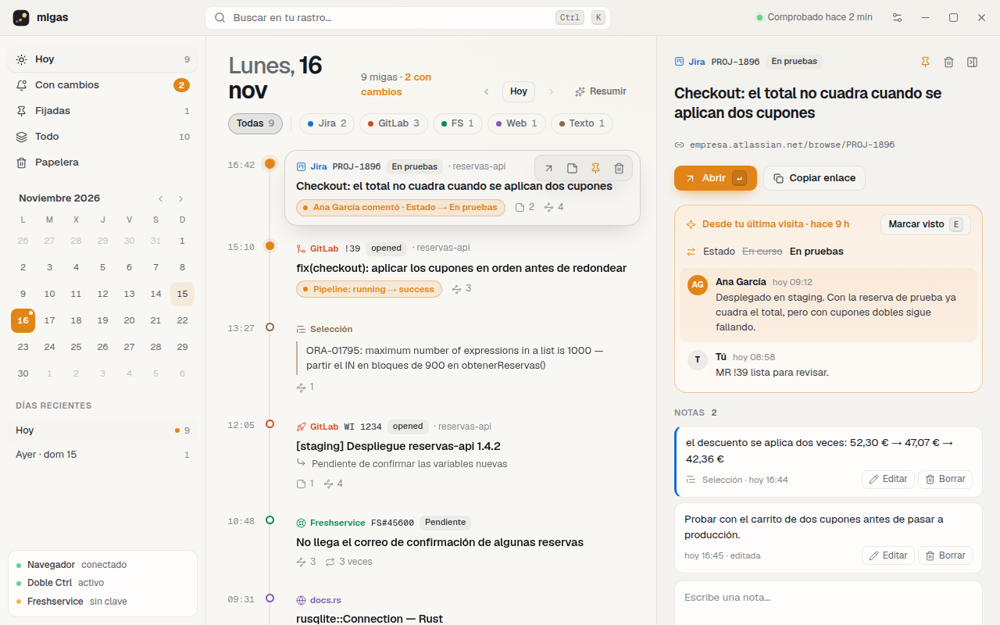
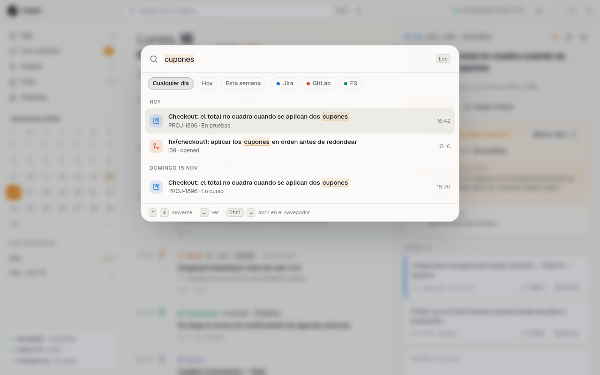
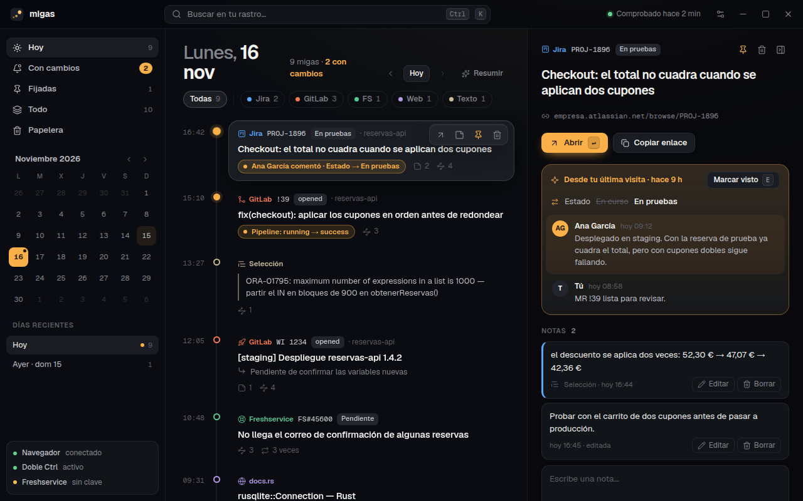
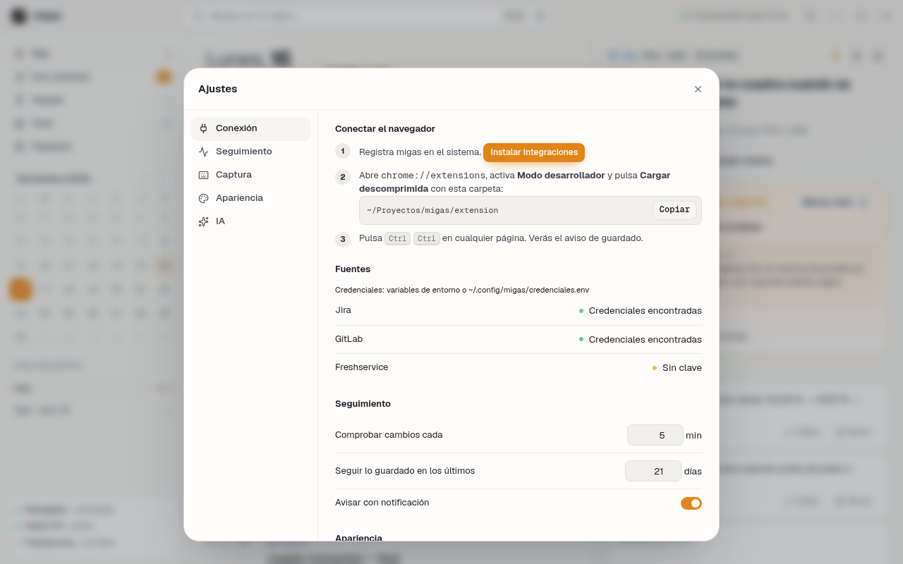

<div align="center">


# migas

### *El rastro de tu día de trabajo, con un doble Ctrl*

[](https://www.rust-lang.org)
[](https://tauri.app)
[](https://www.sqlite.org/fts5.html)
[](#-instalación)
[](#-fuentes-y-credenciales)
[](#-fuentes-y-credenciales)
[](#-fuentes-y-credenciales)
[](#-resumen-del-día-con-ia)
[](LICENSE)

**Pulsa Ctrl dos veces y migas guarda lo que estás mirando: la página del navegador, una issue de Jira, un MR de
GitLab, un ticket de Freshservice o el texto que tengas seleccionado. Todo queda en un diario por días, se relaciona
solo y te avisa cuando algo de lo guardado cambia.**

</div>

---



## ✨ Qué hace

- ⌨️ **Doble Ctrl en cualquier sitio**: en el navegador guarda la página (con la extensión); fuera de él, el texto
  seleccionado. También con `Alt+Shift+M` en Chrome o `migas --capturar`.
- 📅 **Diario por días**: línea de tiempo con filtros por fuente, calendario, fijadas, papelera y notas en cada miga.
- 🔗 **Relaciones automáticas**: une lo que comparte clave (`PROJ-123`, `!39`, `#12`, `FS#45600`), aplicación o
  proyecto, aunque lo guardaras en días distintos.
- 🔔 **Avisos de cambios**: vigila lo guardado en los últimos días y te dice qué ha cambiado desde tu última visita:
  estado, comentarios nuevos, pipeline, asignado…
- 🔎 **Búsqueda instantánea** (`Ctrl+K`) con texto completo sobre títulos, URLs, notas y selecciones.
- 🤖 **Resumen del día con IA**: viñetas por tarea a partir de tus migas, con cualquier API compatible con OpenAI.
- 🔒 **Local**: una base SQLite en tu equipo. Lo único que sale son las consultas a tus propias instancias de Jira,
  GitLab o Freshservice, y a la IA si la activas.



## 📦 Requisitos

- Linux (probado en GNOME sobre Wayland).
- Rust estable (edición 2024), Node.js 20+ y las librerías de desarrollo de WebKitGTK 4.1 y GTK 3 para Tauri v2.
- Google Chrome o Chromium para la extensión.
- Para el doble Ctrl global: tu usuario en el grupo `input` (`sudo usermod -aG input $USER` y volver a iniciar
  sesión). Solo se lee la tecla Ctrl.
- `wl-paste` (Wayland) o `xclip` (X11) para leer la selección; `notify-send` para las notificaciones.

## 🚀 Instalación

```sh
git clone https://github.com/carlos-anpr/migas.git
cd migas
npm ci
npm run tauri build -- --no-bundle
install -Dm755 src-tauri/target/release/migas ~/.local/bin/migas
migas
```

Después, en **Ajustes → Conexión**:

1. **Instalar integraciones**: registra el host de mensajería nativa de Chrome, el lanzador y el inicio automático.
2. En `chrome://extensions` activa el *Modo desarrollador*, pulsa **Cargar descomprimida** y elige la carpeta
   `extension/` del repositorio.
3. Pulsa `Ctrl` `Ctrl` en cualquier página: verás el aviso de guardado.

## 🔑 Fuentes y credenciales

migas no lleva ninguna cuenta, URL ni clave dentro. Las credenciales se leen de **variables de entorno** o de
`~/.config/migas/credenciales.env` (el entorno manda). Solo viven en memoria y nunca llegan a la interfaz.

```ini
# ~/.config/migas/credenciales.env   (chmod 600)
JIRA_USER=tu@correo.com
JIRA_API_TOKEN=...
GITLAB_TOKEN=...
FRESHSERVICE_API_KEY=...
MIGAS_IA_API_KEY=...
```

Si falta una, solo deja de funcionar esa fuente. Las direcciones de tus instancias van en
`~/.config/migas/settings.json`:

```json
{
  "jiraBaseUrl": "https://tu-empresa.atlassian.net",
  "gitlabBaseUrl": "https://gitlab.com",
  "fsBaseUrl": "https://tu-empresa.freshservice.com",
  "prefijosJira": ["PROJ"],
  "repoWi": ""
}
```

- `prefijosJira`: claves de proyecto que se reconocen en texto libre (`PROJ-123`). Se aprenden también de las issues
  que guardas.
- `repoWi`: si usáis un repositorio de GitLab como cola de *work items* de todas las apps (p. ej. `despliegues`),
  su nombre. Entonces `WI 123` y sus URLs se reconocen como work items. Vacío = desactivado.

El resto de ajustes (intervalo de comprobación, días de seguimiento, doble Ctrl, tema, IA) se cambian desde la app.

## 🤖 Resumen del día con IA

Actívalo en **Ajustes → IA**. Funciona con cualquier API compatible con OpenAI (`/chat/completions`): Ollama Cloud,
OpenAI, OpenRouter, Groq, un Ollama local… El modelo y el endpoint se eligen en los ajustes o con **variables de
entorno**, que mandan sobre ellos:

| Variable | Qué hace | Ejemplo |
|---|---|---|
| `MIGAS_IA_MODEL` | Modelo | `gpt-5-mini`, `qwen/qwen3.8-27b` |
| `MIGAS_IA_BASE_URL` | URL base de la API | `https://api.openai.com/v1`, `https://openrouter.ai/api/v1` |
| `MIGAS_IA_API_KEY` | Clave | — |

Como migas arranca con la sesión, pon las variables en `~/.config/environment.d/migas.conf` (o la clave en
`credenciales.env`) y vuelve a iniciar sesión.



## ⌨️ Atajos

| Atajo | Acción |
|---|---|
| `Ctrl` `Ctrl` | Guardar la página o la selección |
| `Alt+Shift+M` | Guardar la página (en Chrome) |
| `Ctrl+K` | Buscar |
| `Enter` / `Ctrl+Enter` | Ver la miga / abrirla en el navegador |
| `E` | Marcar los cambios como vistos |

## 🧪 Línea de comandos

```sh
migas                 # abrir la ventana
migas --oculto        # arrancar en segundo plano (lo usa el inicio automático)
migas --capturar      # guardar la selección actual
migas --mostrar 12    # abrir la miga 12
```

Los datos viven en `~/.local/share/migas/migas.db` (o en `MIGAS_DATA_DIR`, útil para pruebas).

## 🛠️ Desarrollo

```sh
npm ci
npm run dev                     # y abre http://localhost:1420/?mock: la UI con datos de ejemplo, sin backend
cd src-tauri && cargo test      # backend: captura, relaciones, seguimiento, IA…
node --test extension/pruebas/detector.test.mjs
npm run tauri dev               # la app completa
```



## 📄 Licencia

[MIT](LICENSE)
